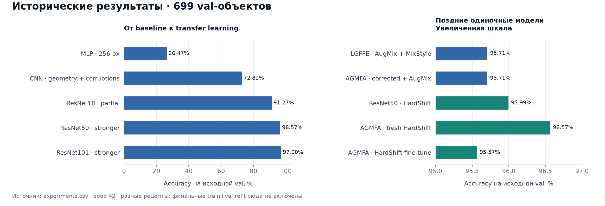
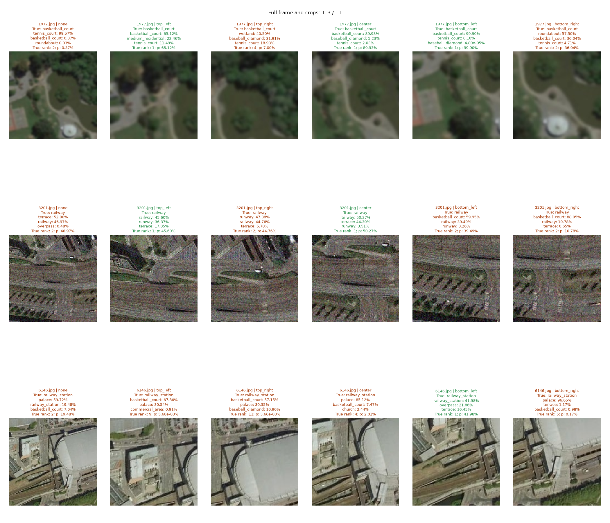
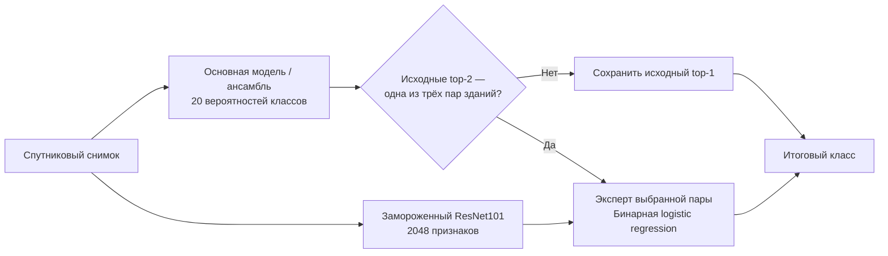
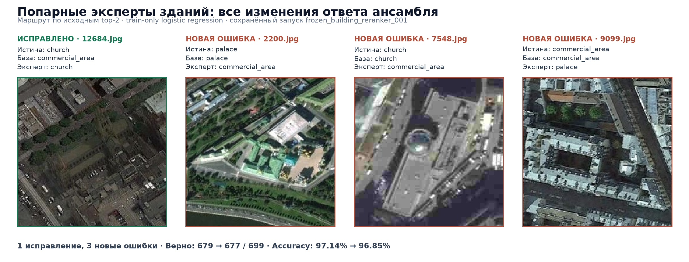
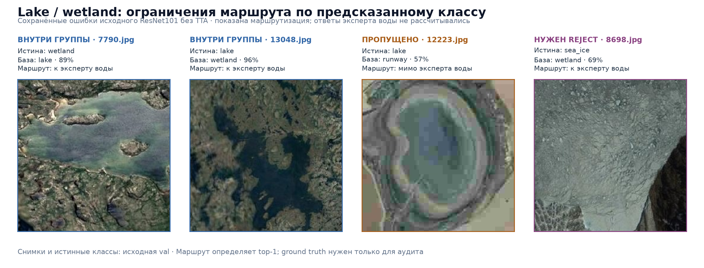
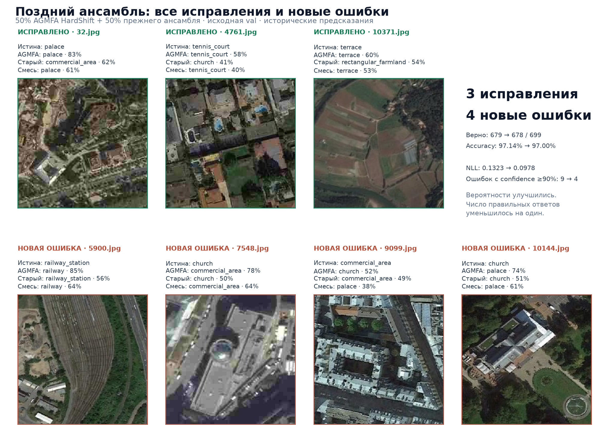
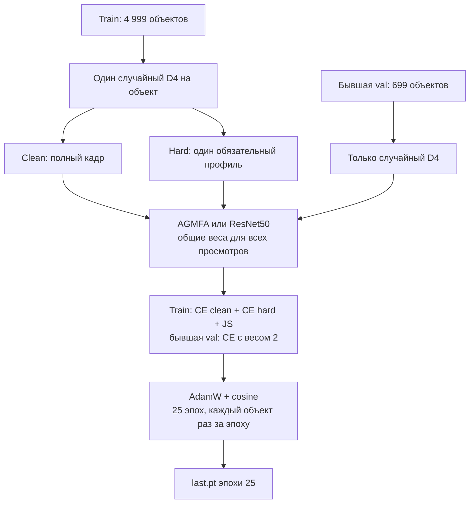
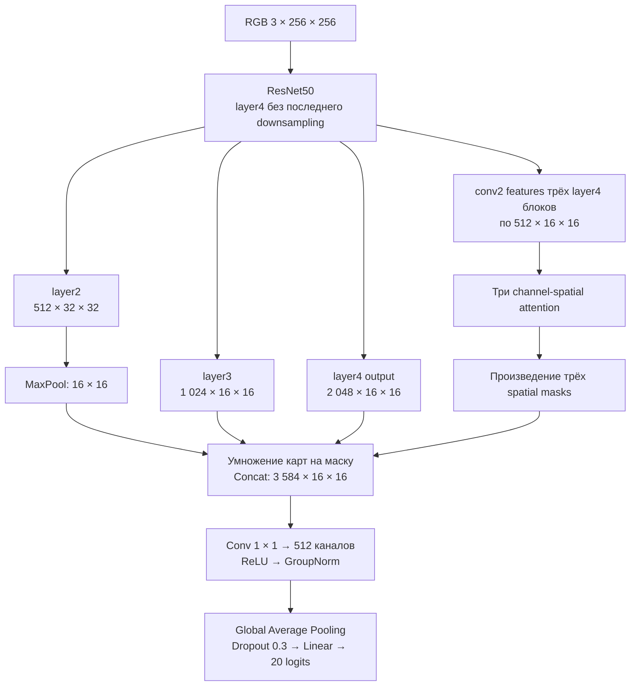
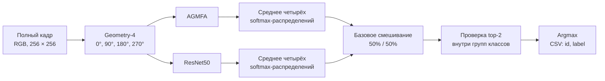

# Satellite Object Classification

**SBMTeam · 20 классов спутниковых снимков · PyTorch · ResNet50 + AGMFA**

Решение соревнования по классификации объектов и сцен на спутниковых снимках. По одному RGB-изображению нужно определить класс: церковь, дворец, железнодорожную станцию, озеро, спортивную площадку и другие объекты. Главная сложность — распознавать небольшие детали при разном качестве съёмки и отличать визуально похожие сцены.

Мы прошли путь от MLP и собственной CNN до transfer learning, анализа ошибок, локальных признаков, attention и обучения на тяжёлых искажениях. Текущий финальный рецепт — **две независимо обученные модели, AGMFA и ResNet50, HardShift, Geometry-4 TTA и смешивание вероятностей с фиксированными правилами для похожих классов**.

Лучший исторический ансамбль распознал **679 из 699 объектов val — 97.14%**. Это результат исследовательской части. Для нового 25-эпохового рецепта в `final/` сохранённых результатов пока нет; его качество не приравнивается к прежнему ансамблю.

[Данные](#данные) · [Эксперименты](#как-развивалось-решение) · [Похожие классы](#почему-путаются-похожие-объекты) · [Эксперты](#каскад-экспертов) · [Поздние результаты](#что-показали-поздние-эксперименты) · [Финальный рецепт](#финальный-рецепт) · [Запуск](#как-запустить)

## Данные

В [предоставленном архиве](https://drive.google.com/file/d/1sbnKeVmiOmT4ZZHIbXIxuBWF9CQLWt6s/view) — 20 классов. Основная метрика при разработке — Accuracy на исходном `val`.

| Выборка | Изображений | Роль |
| --- | ---: | --- |
| `train` | 4 999 | Обучение и проверка гипотез об аугментациях |
| `val` | 699 | Сравнение исследовательских моделей; затем включается в финальное обучение |
| `test` | 8 299 | Предсказания для submission |

Train и val почти сбалансированы: по 250 и 35 примеров каждого класса, кроме `palace` в train — 249 и `bridge` в val — 34. Соответствие числовых меток названиям задаёт `classes.csv`.


*Сверху — train, снизу — val. В каждой колонке один класс, но разные объекты. Среди примеров есть размытые снимки, маленькие площадки, тени и различия в цвете: одного узнаваемого фона для классификации недостаточно.*

В финальной обработке сохраняется **полный кадр 256 × 256**, используется RGB и ImageNet-нормализация. Train и val читаются из отдельных каталогов; код не объединяет их по имени файла.

## Как развивалось решение

Первый MLP работал с развёрнутыми пикселями. Увеличение разрешения и регуляризация не сделали его конкурентным: пространственная структура почти не используется. Собственная CNN дала заметный прирост. В отдельном сравнении одной и той же CNN геометрия подняла Accuracy с **69.81% до 72.39%**, а фотометрия и ухудшения съёмки довели её до **72.82%**.

Самый большой следующий шаг — **предобученные ResNet**. У ResNet18 обучение только головы дало 82.12%, частичная разморозка — 91.27%. Для ResNet50 partial оказался сильнее full: 94.85% против 93.71%. Размытие и снижение разрешения стали полезными аугментациями; усиленный рецепт ResNet50 достиг 96.57%, ResNet101 — 97.00%.



*График построен по `experiments.csv`. Слева — развитие базовых моделей, справа — поздние одиночные модели. Это сравнение рецептов; условия разных архитектур не являются одной общей абляцией. Справа шкала увеличена, чтобы показать небольшие различия.*

<details>
<summary>Точные запуски, использованные на графике</summary>

| Запуск | Val Accuracy |
| --- | ---: |
| `mlp_004` | 26.47% |
| `cnn_domain_shift_001` | 72.82% |
| `resnet18_partial_001` | 91.27% |
| `resnet50_partial_domain_shift_stronger_001` | 96.57% |
| `resnet101_partial_domain_shift_stronger_001` | 97.00% |
| `resnet50_lgffe_robust_augmix_mixstyle_001` | 95.71% |
| `resnet50_agmfa_robust_augmix_fixed_001` | 95.71% |
| `resnet50_hard_target_shift_001` | 95.99% |
| `resnet50_agmfa_hard_target_shift_001` | 96.57% |
| `resnet50_agmfa_hard_target_shift_finetune_001` | 95.57% |

</details>

Дальше мы проверяли, **какие именно ошибки остаются**. Сравнивали confusion pairs, вероятности всех классов, разрыв между top-1 и top-2, исправления и новые ошибки при добавлении модели. Проверили геометрический TTA, ансамбли, пять локальных crops, Average+Max pooling и попарные классификаторы на замороженных признаках.

Ряд идей не улучшил выбранную базу. RandomResizedCrop снизил результат ResNet50 до 95.14%; label smoothing, вспомогательный CosFace и hard mining также не превзошли stronger-рецепт. LGFFE с GRU-attention, Robust AugMix, MixStyle и отдельным linear SVM исследовали как ветку global/local features; в текущий финальный код она не вошла. Совместные RRC+smoothing и RRC+CutMix остались подготовленными гипотезами без подтверждённого результата.

Подробная история — в [docs/experiments.md](docs/experiments.md), все зарегистрированные обучения — в [experiments.csv](experiments.csv).

## Почему путаются похожие объекты

Особенно сложна группа **`church / palace / commercial_area`**. Сверху церковь не всегда выглядит как привычный храм: видны крыша, двор, парковка и соседние здания. Дворец может выглядеть как большой административный или коммерческий комплекс. При размытии исчезают мелкие признаки, а окружающая застройка занимает большую часть изображения. Это визуальное объяснение наблюдаемых ошибок, а не автоматически установленная причина для каждого снимка.

| Группа | Что мешает различать классы | Наши идеи решения |
| --- | --- | --- |
| `church / palace / commercial_area` | Похожие крыши и дворы, сильное влияние окружающей застройки | Локальные crops, attention, попарные классификаторы, мягкое смешивание по top-2 |
| `railway / railway_station` | Пути присутствуют в обеих сценах; важны платформы и здания станции | Сохранение полного контекста, анализ crops и отдельное правило ансамбля |
| `lake / wetland` | Вода и растительность присутствуют вместе; граница объектов неоднозначна | Анализ берегов и контекста, аугментации цвета, аудит возможных специалистов |
| `basketball_court / tennis_court` | Площадка мала, разметка теряется в тени или размытии | Геометрия, устойчивость к деградациям, локальные признаки и более подробные feature maps |

**Локальные crops.** Мы проверяли углы и центр: в отдельных случаях увеличение нужного участка меняло ответ на правильный. Но crop может убрать важный контекст или показать другой объект. Фиксированное объединение global/local не дало надёжного общего выигрыша; факт, что хотя бы один crop угадал класс, не означает, что рабочий ансамбль умеет выбрать его.

<details>
<summary>Пример: один снимок, полный кадр и пять локальных просмотров</summary>



*Зелёным отмечены правильные ответы отдельных просмотров, оранжевым — ошибки. На площадке crop помогает увидеть нужный объект, но на станции другие crops уводят классификацию к посторонним классам. Это диагностика ResNet101 на val.*

</details>

**Attention и устойчивость.** LGFFE и AGMFA были попыткой лучше использовать локальные детали. HardShift добавил явное обучение на плохом качестве съёмки. Эти идеи решают разные части проблемы: устойчивость к шуму не устраняет семантическую похожесть зданий, а attention не гарантирует правильного ответа. В текущем финальном рецепте оставили AGMFA вместе с обычной ResNet50 и предусмотрели разные доли моделей внутри двух групп классов.

### Каскад экспертов

Проверяли идею: **основная модель распознаёт все 20 классов, а специалист уточняет ответ внутри проблемной группы**. Группы — `church / palace / commercial_area`, `lake / wetland` и `basketball_court / tennis_court`. В [ноутбуке 06](archive/notebooks/06_tta_ensembles.ipynb) оценили маршрутизацию по предсказанному классу; в [ноутбуке 08](archive/notebooks/08_frozen_pairwise_experiments.ipynb) выполнили обучение и проверку трёх попарных экспертов зданий с маршрутизацией по top-2.



**Выполненный запуск `frozen_building_reranker_001`.** Эксперты различали `church/palace`, `church/commercial_area` и `palace/commercial_area`. Для них извлекли признаки 749 train-объектов зданий; стандартизацию и logistic regression обучали только на train соответствующей пары. Backbone оставался замороженным, `C=1` был фиксирован заранее. На val эксперт получал снимок, если **оба исходных top-2 образовывали его пару**, и заменял ответ базовой модели своим. Истинный класс и порог уверенности маршрут не определяли.

| Основание каскада | До экспертов | После экспертов | Отправлено экспертам | Исправлено / испорчено |
| --- | ---: | ---: | ---: | ---: |
| ResNet101 без TTA | 678 / 699 | 677 / 699 | 83 | 1 / 2 |
| ResNet101 + ResNet50 stronger D4 | 679 / 699 | 677 / 699 | 87 | 1 / 3 |

Для прежнего лучшего ансамбля результат зависел от пары:

| Эксперт | Отправлено | Исправлено | Испорчено |
| --- | ---: | ---: | ---: |
| `church / palace` | 42 | 0 | 0 |
| `church / commercial_area` | 22 | 1 | 1 |
| `palace / commercial_area` | 23 | 0 | 2 |



*Все изменения ансамбля из выполненного ноутбука 08. На `12684.jpg` эксперт исправил `commercial_area → church`. На `2200.jpg`, `7548.jpg` и `9099.jpg` он заменил правильные ответы ошибочными. Исходные фото и истинные метки взяты из val; ответы экспертов — из сохранённого вывода.*

Каскад снизил Accuracy ансамбля **с 97.14% до 96.85%**, поэтому этих экспертов в выбранное решение не включили. Хорошая отдельная бинарная модель ещё не гарантирует улучшения всей системы: к ней поступают и уже правильно распознанные объекты. В этом запуске истинные классы всех 87 направленных снимков даже принадлежали соответствующим парам, но баланс исправлений и новых ошибок оказался отрицательным.

<details>
<summary>Lake / wetland и другие группы: проверка маршрутизации и конкретные ошибки</summary>

В ноутбуке 06 проверяли более простой маршрут: отправлять снимок специалисту, если **исходный top-1 входит в его группу**. Сохранённый аудит относится к `resnet50_partial_domain_shift_stronger_001` на всех 699 val-объектах:

| Группа | Отправлено | Уже верны | Ошибки внутри группы | Посторонние объекты | Ошибки группы вне маршрута |
| --- | ---: | ---: | ---: | ---: | ---: |
| `church / palace / commercial_area` | 106 | 96 | 8 | 2 | 1 |
| `lake / wetland` | 69 | 66 | 3 | 0 | 1 |
| `basketball_court / tennis_court` | 67 | 65 | 2 | 0 | 3 |

Внутри трёх групп потенциально исправлялись **13 из 24 ошибок** базы. Одновременно к экспертам попадали **227 уже правильных ответов**, а ещё пять ошибок на объектах этих групп маршрут пропускал. Расчётный предел 98.43% предполагал идеальных специалистов без новых ошибок. **Это аудит идеи, а не измеренная Accuracy обученных экспертов воды и площадок**; их отдельное обучение в этом ноутбуке не выполнялось.



*Здесь показаны сохранённые ответы исходного ResNet101 без TTA, чтобы проиллюстрировать ограничения маршрута. Это другой базовый классификатор, чем в таблице аудита выше; ответы водного эксперта на этих снимках не рассчитывались.*

`7790.jpg` и `13048.jpg` демонстрируют путаницу внутри `lake / wetland`: такие снимки поступили бы специалисту воды. Но настоящий `lake` на `12223.jpg` распознан как `runway` и при маршрутизации по top-1 до него не дойдёт. Обратный случай — `8698.jpg`: настоящий `sea_ice` принят за `wetland`; бинарный эксперт воды вынужден выбрать один из двух неподходящих классов. Для зданий аналогичная проблема возникает при `church → medium_residential`.

</details>

Наши идеи продолжения — маршрут по top-2, мягкое смешивание вероятностей вместо обязательной замены ответа, специалист с `other/reject` для посторонних объектов и локализация нужного объекта. Top-2 уже проверили в попарном запуске выше; остальные варианты требуют отдельной оценки. Проверять продолжение нужно по исправлениям **и** новым ошибкам на отдельном holdout: исходная val многократно использовалась для выбора решений.

## Что показали поздние эксперименты

В заключительной исследовательской проверке смешали **50% AGMFA HardShift и 50% прежнего ансамбля**. Прежний ансамбль — поровну ResNet101 без TTA и ResNet50 stronger с D4. AGMFA здесь — train-only checkpoint по минимальному val loss, эпоха 22 из 24; это отдельный исторический запуск.

| Рецепт на исходной val | Верно / 699 | Accuracy | NLL ↓ | Ошибок с уверенностью ≥90% ↓ |
| --- | ---: | ---: | ---: | ---: |
| AGMFA HardShift, best loss | 674 | 96.42% | 0.1100 | 4 |
| Прежний ансамбль ResNet101 + ResNet50 D4 | **679** | **97.14%** | 0.1323 | 9 |
| 50% AGMFA + 50% прежнего ансамбля | 678 | 97.00% | **0.0978** | **4** |

Смешивание **исправило 3 ответа и испортило 4**. NLL и число очень уверенных ошибок уменьшились, но Accuracy не выросла. Это хороший пример того, почему качество вероятностей и качество итогового argmax нужно оценивать отдельно.



*Все семь случаев из сохранённого вывода [ноутбука 18](archive/notebooks/18_probability_fusion.ipynb). Фотографии взяты из предоставленного датасета, метки сверены с `val.csv`; предсказания восстановлены из исторического вывода, без повторного inference.*

На `32.jpg` AGMFA исправила `palace`, ранее принятый за `commercial_area`. Обратная сторона — `7548.jpg` и `10144.jpg`: смесь заменила правильный `church` на `commercial_area` и `palace`. Для группы `church/palace` число ошибок изменилось **8 → 9**, для `railway/railway_station` — **1 → 2**, для `lake/wetland` осталось **4 → 4**, для двух типов площадок уменьшилось **4 → 3**. Это ошибки на объектах соответствующих истинных классов, включая предсказания вне группы.

В архиве есть и выполненный AGMFA refit на train+val с фиксированными 22 эпохами. Он отличается от нового 25-эпохового рецепта. После включения val в обучение её показатели уже не являются независимой оценкой. Итоговый leaderboard score в журнале не заполнен; приведённые здесь проценты относятся к val.

## Финальный рецепт

### Обучение: полный кадр и HardShift

Обе модели стартуют со свежих **ResNet50 ImageNet V2** весов. Первые три эпохи обучаются новые head-параметры; у AGMFA это также attention и fusion. Затем размораживаются `layer3` и `layer4`. Статистики backbone BatchNorm остаются замороженными.



D4 — восемь точных геометрических вариантов: четыре поворота и их зеркальные отражения. Clean и hard получают **одну и ту же геометрию**. Для hard обязательно применяется один из шести профилей: затемнение и grayscale, blur/low-resolution, сумеречный цветовой сдвиг, дымка/низкий контраст, наклон съёмки или шум/JPEG.


*Это синтетические train-преобразования из поздних экспериментов. Они иллюстрируют условия, к которым модель учится быть устойчивой; это не предсказания на test.*

Для исходного train-объекта используется функция потерь:

$$
\mathcal{L}_{\mathrm{source}} =
\frac{1}{2}\operatorname{CE}(z_{\mathrm{clean}}, y)
+ \frac{1}{2}\operatorname{CE}(z_{\mathrm{hard}}, y)
+ 3\operatorname{JS}(p_{\mathrm{clean}}, p_{\mathrm{hard}}).
$$

Здесь CE учит правильному классу, а Jensen–Shannon divergence согласует вероятности двух просмотров. Для бывшей val применяются только D4 и CE с весом 2; синтетических hard-искажений нет. Общий loss нормируется на сумму весов исходных объектов.

| Параметр | Обе финальные модели |
| --- | --- |
| Вход | Полный RGB-кадр 256 × 256 |
| Инициализация | `IMAGENET1K_V2`, seed 42 |
| Fine-tuning | 3 эпохи head warmup, затем head + `layer3/layer4` |
| Оптимизатор | AdamW, weight decay 0.001 |
| Learning rate | Backbone: `5e-5`; head: `5e-4` |
| Scheduler | Cosine, `T_max=25`, `eta_min=1e-6` |
| Batch size | 16 исходных объектов; train-пара даёт два изображения |
| Завершение | Фиксированная эпоха 25, `last.pt` |

### AGMFA: детали и контекст на нескольких уровнях

AGMFA построена по идее [attention-guided multilayer feature aggregation](https://www.mdpi.com/2072-4292/13/16/3113): attention направляет объединение нескольких уровней признаков. В нашей реализации `layer4` сохраняет сетку **16 × 16**, три channel/spatial attention-ветки используют внутренние `conv2 → bn2 → ReLU` features, а fusion объединяет полные выходы `layer2`, `layer3` и `layer4`.

<details>
<summary>Схема AGMFA и размеры карт признаков без batch-оси</summary>



В прежней версии attention читала полные bottleneck outputs. После проверки реализации taps исправили на внутренние 512-канальные conv2 features. Для новой fusion используется GroupNorm с 32 группами и 512 каналами — это настройка данного проекта. Обычная ResNet50 сохраняет свою отдельную классификационную голову.

</details>

### Применение: Geometry-4 и условное смешивание



Усредняются **вероятности** четырёх поворотов каждой модели. Geometry-4 при применении отличается от восьми вариантов D4, используемых в обучении.

Если оба top-2 базового ансамбля принадлежат одной группе, меняется распределение вероятностей **только внутри неё**:

| Группа | Доля AGMFA | Доля ResNet50 |
| --- | ---: | ---: |
| `church / palace / commercial_area` | 75% | 25% |
| `railway / railway_station` | 25% | 75% |
| Общий случай | 50% | 50% |

При пересмешивании сохраняются суммарная вероятность группы и вероятности остальных классов. Маршрут определяется предсказаниями; истинная метка для него не нужна. Это фиксированный рецепт текущей версии, его выигрыш после нового refit пока не измерен.

## Как запустить

Из корня проекта, в окружении с **Python 3.12+** и совместимыми PyTorch/torchvision. Обучение рассчитано на GPU; `--device auto` выбирает CUDA при наличии, иначе CPU.

```bash
python -m pip install -r final/requirements.txt gdown

mkdir -p data
gdown 1sbnKeVmiOmT4ZZHIbXIxuBWF9CQLWt6s -O data/satellite-data.zip
python -m zipfile -e data/satellite-data.zip data/raw
```

Ожидаемая структура данных:

```text
data/raw/
├── classes.csv
├── train.csv
├── val.csv
├── sample_submission_example.csv
├── train/
├── val/
└── test/
```

Обучить обе модели:

```bash
python -m final.src.runner train \
  --raw-dir data/raw \
  --run-id final_001
```

Можно запускать модели отдельно с `--model agmfa` и `--model resnet50`, используя один run ID. Размер батча задаётся через `--batch-size`. ImageNet-веса скачивает torchvision; для автономной инициализации передайте `--imagenet-weights /path/to/resnet50-11ad3fa6.pth`. Для повторного обучения нужен новый run ID; точный resume прерванного запуска не реализован.

После завершения обеих моделей:

```bash
python -m final.src.runner predict \
  --agmfa-checkpoint artifacts/models/final_001_agmfa/last.pt \
  --resnet50-checkpoint artifacts/models/final_001_resnet50/last.pt \
  --sample-csv data/raw/sample_submission_example.csv \
  --image-dir data/raw/test \
  --output-dir submissions/final_001
```

Результат: `agmfa.csv`, `resnet50.csv`, **`ensemble.csv`**, три NPZ с ID/классами/вероятностями и `recipe.json`. Из шаблона читаются только ID; порядок строк сохраняется. Каталог вывода должен быть новым. Предсказание принимает checkpoints завершённой эпохи 25.

Пошаговый вариант — [финальный ноутбук](final/notebooks/01_final_pipeline.ipynb); детали — [final/README.md](final/README.md). Логи финального обучения содержат train-метрики, включая бывшую val; отдельной валидации, early stopping и выбора best checkpoint здесь нет.

Проверки реализации на синтетических данных:

```bash
python -m unittest discover -s final/tests -v
python -m unittest discover -s archive/tests -t . -v
```

Они проверяют, в частности, разделение источников данных, проход каждого объекта раз за эпоху, фиксированный checkpoint, Geometry-4, сохранение вероятностной массы групп и экспорт CSV. Эти проверки не измеряют качество моделей на соревновании.

## Навигация по репозиторию

```text
final/
├── src/                 Финальное обучение, модели, inference и ансамбль
├── configs/             AGMFA, ResNet50, правило смешивания
├── notebooks/           Один пошаговый финальный pipeline
└── tests/               Синтетические проверки финальной реализации
archive/
├── src/                 Исторические модели, обучение и анализ ошибок
├── configs/             Выполненные рецепты и подготовленные гипотезы
├── notebooks/           EDA, baselines, transfer, crops, LGFFE, AGMFA, HardShift
└── tests/               Проверки исследовательских реализаций
docs/
├── experiments.md       История гипотез и выводов
└── assets/              Иллюстрации README и сведения об их происхождении
experiments.csv          Журнал исторических и новых обучений
```

Датасет, checkpoints, полные логи и submissions скачиваются или создаются отдельно и исключены из Git. Для знакомства с ходом исследования полезны [анализ ошибок](archive/notebooks/05_error_analysis.ipynb), [TTA и локальные просмотры](archive/notebooks/06_tta_ensembles.ipynb), [попарные классификаторы](archive/notebooks/08_frozen_pairwise_experiments.ipynb), [AGMFA](archive/notebooks/14_resnet50_agmfa.ipynb) и [HardShift](archive/notebooks/15_hard_target_shift_training.ipynb).

Источники фотографий, исторических предсказаний и графика указаны в [docs/assets/README.md](docs/assets/README.md). Иллюстрации поздних экспериментов относятся к train/val-исследованиям и не выдаются за результат нового финального обучения.
