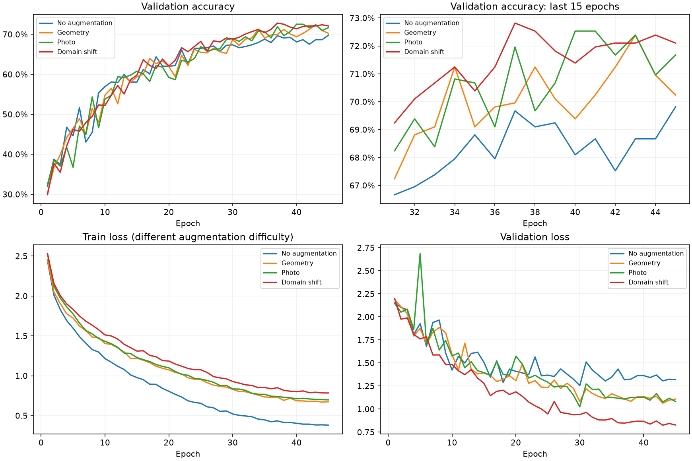
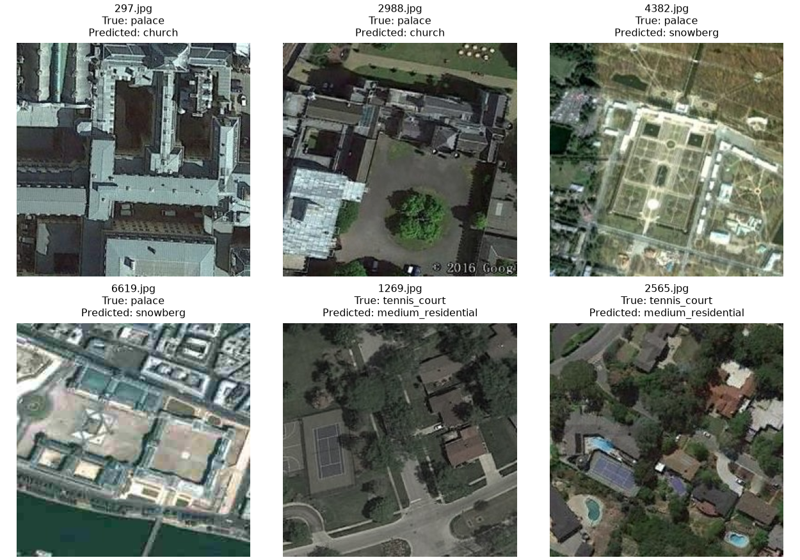

# Результаты CNN и дальнейшие эксперименты

Проверка 2026-10-05. Вывод: текущей серии достаточно, чтобы перейти к pretrained. Дополнительный широкий поиск по собственной CNN сейчас не приоритетен. Лучший единичный результат — domain_shift, но его преимущество по Accuracy над geometry/photo слишком мало для уверенного выбора аугментаций.

## Проверенные результаты

Источник: experiments.csv; artifacts/logs/<exp_id>/{config,metadata,summary}.json и history.csv; artifacts/predictions/<exp_id>/val.csv; best/last.pt; data/raw/val.csv и classes.csv.
Все пять запусков выполнены на Tesla T4, CUDA, seed=42. В четырёх matched-рецептах совпадают конфиги, кроме augmentation, notes и exp_id: вход256, batch32, 45 эпох, 1 114 892 параметра, AdamW и cosine.

| Запуск | Best val Accuracy | Верных / 699 | Лучшая эпоха / всего | Время, мин |
| --- | --- | --- | --- | --- |
| cnn_001: простой baseline | 54.94% | 384 | 35 / 40 | 10.36 |
| cnn_no_aug_001 | 69.81% | 488 | 45 / 45 | 23.45 |
| cnn_geometry_001 | 72.39% | 506 | 43 / 45 | 16.45 |
| cnn_photo_001 | 72.53% | 507 | 40 / 45 | 21.99 |
| cnn_domain_shift_001 | 72.82% | 509 | 37 / 45 | 26.45 |

Журнал, summary, максимум history и Accuracy, вычисленная по сохранённым predictions против raw val, совпали. Ровно 699 уникальных ID, верный порядок при сопоставлении по ID, true_label соответствует исходной val; истории полные, метрики конечные. Проверены артефакты и состояния best/last checkpoints. Результаты повторного CPU-inference зафиксированы в cnn_audit.json.
Некоторые сохранённые exp_id отличаются от названий локальных папок после переноса с Kaggle (например cnn_256_no_aug_s42_001 → cnn_no_aug_001). Это переименование упаковки результатов; config, метрики и predictions проверяются независимо, исходные артефакты не переписываются.

## Что дали изменения

Переход от простого baseline к matched CNN без аугментаций дал +14.88 п.п. и 104 дополнительных правильных ответа. Одновременно менялись архитектура, optimizer, scheduler и длительность: это эффект целого рецепта, нельзя приписать весь прирост одной архитектуре.
Лучшая MLP классифицировала 185/699 (26.47%); собственная CNN — 509/699. Требуемое сравнение MLP/CNN уже содержательно выполнено.

Геометрия против no_aug: +2.58 п.п. и 18 изображений.
Photo против geometry: +0.14 п.п. и одно изображение.
Domain_shift против geometry: +0.43 п.п. и три изображения; против photo — два.
Это наблюдения одного seed на одной val, а не доказательство, что полный набор всегда лучше.

По парным ошибкам domain_shift исправляет 53 ошибки geometry и одновременно портит 50 её правильных ответов. Малый чистый прирост скрывает существенное изменение ошибок.
Для no_aug → domain_shift исправлены 70, испорчены 49. Для geometry → photo исправлены 39, испорчены 38.
В JSON сохранён exploratory exact McNemar: geometry/domain_shift p≈0.844, photo/domain_shift p≈0.914. Это не подтверждает превосходство полного набора по Accuracy. Тесты не учитывают выбор лучшей эпохи, перебор рецептов и вариативность seeds, поэтому используются только как дополнительная описательная диагностика.

## Обучение и обобщение

| Рецепт | Последний train Accuracy | Последний val Accuracy | Последний train loss | Последний val loss | Средняя val Accuracy последних 10 эпох |
| --- | --- | --- | --- | --- | --- |
| No aug | 86.96% | 69.81% | 0.380 | 1.320 | 68.74% |
| Geometry | 76.82% | 70.24% | 0.675 | 1.109 | 70.56% |
| Photo | 76.52% | 71.67% | 0.699 | 1.083 | 71.32% |
| Domain shift | 73.39% | 72.10% | 0.784 | 0.828 | 72.05% |

У no_aug заметный разрыв train/val, при хорошем fitting train слабее обобщение. Аугментации усложняют train и уменьшают этот разрыв. Прямое сравнение train Accuracy разных рецептов ограничено: train измеряется с dropout и разной сложностью преобразований, val — в eval на исходных снимках.
У domain_shift в лучшей эпохе train 70.89%, val 72.82%; это согласуется с более трудным train-протоколом и само по себе не указывает на утечку или недообучение.
Full domain_shift имеет существенно меньший validation CrossEntropy и менее колеблющуюся Accuracy в конце обучения. Среднее последних10 эпох — 72.05% против 70.56% geometry; std по эпохам 0.48 против 0.89 п.п. Эти эпохи зависимы и не являются независимыми повторами. Меньший loss не доказывает лучшую калибровку без отдельного анализа вероятностей.
К 35–45 эпохам Accuracy близка к плато, хотя loss продолжает улучшаться. Резкое увеличение epochs сейчас менее приоритетно, чем pretrained. Best на последней эпохе no_aug само по себе не доказывает, что ещё 50 эпох дадут существенный прирост; cosine уже снизил LR почти до минимума.

## Где остаются ошибки

Val почти сбалансирована: по35 изображений на класс, bridge34. Для domain_shift худшие recall:
palace13/35=37.14%; tennis_court15/35=42.86%; roundabout17/35=48.57%; church19/35=54.29%; basketball_court20/35=57.14%.
Хорошие классы: snowberg35/35, bridge33/34, runway33/35. При 35 примерах изменение одного правильного ответа меняет recall класса на2.86 п.п.; малые различия нестабильны.

Частые ошибки domain_shift: palace → church9; palace → snowberg6; tennis_court → medium_residential8.
Геометрия лучше domain_shift на church (23 против19), palace (15 против13), tennis_court (19 против15), а photo лучше на palace (18 против13). Полный набор помогает не всем классам; эти различия одного запуска ещё не устанавливают причинность конкретной аугментации.
Все четыре matched-модели одновременно ошибаются на114 изображениях val.

Просмотрены по два примера трёх указанных типов ошибок. В примерах теннисный корт занимает часть кадра и окружён жилыми зданиями/деревьями; среди palace есть сложные структуры крыш и яркие/размытые кадры. Гипотеза: нужны более сильные признаки формы, объекта и контекста, а не только устойчивость к шуму. Шесть целенаправленно выбранных ошибок не репрезентативны для всего распределения. Метки не переопределяются.
Если ошибкам court потребуется адресное исследование, первым кандидатом будет ослабление blur/resolution_degradation, но сейчас это только гипотеза, а не доказанный источник ошибок.

## Время

Сравнивать только общее время некорректно: у no_aug первая эпоха203.6с, у geometry67.3с. В истории есть стартовые замедления, причина по логам не установлена; возможны загрузка/кеширование и нагрузка среды.
Медиана последних10 эпох: no_aug20.7с, geometry20.4с, photo27.9с, domain_shift33.1с. Полный набор примерно на62% дороже geometry в этой фазе. Из этого не следует гарантированная такая же разница на другом запуске/GPU.

## Решение и порядок следующей серии

1. Перейти к pretrained через 03_pretrained.ipynb. Начать с ResNet18 head_only (15 эпох), затем partial (25 эпох: warmup3, layer4 + head). Это сравнит готовые признаки и адаптацию верхнего блока. В текущих конфигах одинаковые отражения; сохранить их в первых двух запусках, чтобы не менять одновременно режим и набор аугментаций. Длительности и LR различаются — сравнение целых рецептов, а не чистая абляция одного параметра.
2. Затем проверить ResNet18 full (30 эпох), если partial даёт полезный результат и требуется большая адаптация. ResNet50 partial (25 эпох) — следующая архитектурная альтернатива; заранее не считаем её лучше.
3. На перспективном pretrained-рецепте отдельно сравнить geometry с domain_shift, сохранив одну архитектуру, режим, optimizer, scheduler, epochs и ImageNet-нормализацию. Не переносить CNN mean/std=[0.5]*3 на pretrained. Выбор аугментаций для CNN не гарантирует такой же порядок на ResNet.
4. Если нужен дополнительный собственный CNN, достаточно одного более глубокого варианта cnn_256_deeper. Для исследования архитектуры использовать ту же augmentation и одинаковый training-бюджет; исходный deeper имеет60 эпох, поэтому его прямое сравнение с45-эпоховой CNN оценивает весь рецепт. Этот запуск необязателен перед pretrained.
5. Повторить geometry/domain_shift с seeds123 и2026, если потребуется надёжно выбрать лучший CNN. Seed42 уже есть: получится по три повтора. Держать всё остальное неизменным; сравнить среднее/разброс. Повторы полезнее широкого случайного перебора шума, dropout и LR; их можно отложить до выбора финального семейства.

Сейчас не увеличивать интенсивность и число искажений, не добавлять широкую сетку LR/dropout и не делать агрессивные crop. Подбор по одной val постепенно переобучает решения на эту val, поэтому новые запуски должны проверять конкретные гипотезы. Test остаётся вне подбора и fitting. Результаты CNN сохраняются как проверенный ориентир; новые pretrained-запуски получают уникальные exp_id.

Режимы frozen feature extractor и fine-tuning описаны в [официальном руководстве PyTorch](https://docs.pytorch.org/tutorials/beginner/transfer_learning_tutorial). Порядок экспериментов выше — рекомендация по текущим результатам, а не утверждение о гарантированном превосходстве ResNet.

