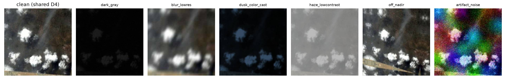

# Hard Target-Shift Training

Три отдельных кандидата в `notebooks/15_hard_target_shift_training.ipynb`.
Старые configs, модели, checkpoints, журнал и результаты не изменяются.
Это проверка гипотезы о недостаточном покрытии domain shift; качество новых
моделей пока неизвестно. Реальное обучение не запускалось.

| Choice | Config | Initialization | Fine-tuning | Epochs | Backbone/head LR |
|---|---|---|---|---|---|
| A | resnet50_hard_target_shift.json | ImageNet V2, новая голова | layer3/4, warmup3 | 24 | 5e-5 / 5e-4 |
| B | resnet50_agmfa_hard_target_shift.json | ImageNet V2, новая corrected AGMFA | layer3/4, warmup3 | 24 | 5e-5 / 5e-4 |
| C | resnet50_agmfa_hard_target_shift_finetune.json | corrected AGMFA best.pt | layer2/3/4, warmup0 | 12 | 1e-5 / 5e-5 |

Все: AdamW, WD0.001, cosine T_max=число эпох, eta_min1e-6, seed42,
backbone BN frozen. В warmup новые attention/fusion/head обучаются с head LR;
затем подключаются указанные слои backbone. C загружает только веса из
`artifacts/models/resnet50_agmfa_robust_augmix_fixed_001/best.pt`, проверяет
архитектуру, conv2 taps, порядок классов, resolution, normalization и state shapes.
Optimizer/scheduler создаются заново. Старый optimizer state не восстанавливается.

## Объект, две версии, один label

Для каждого train sample `i` на эпохе `e` (нумерация с 1):
`profile_id = (i+e)%6`. За любой блок из шести последовательных эпох объект
проходит каждый profile ровно один раз. В A/B получается четыре полных цикла,
в C — два. Epoch хранится в shared torch tensor и виден persistent workers.
Случайные параметры берутся из локального NumPy Generator с SeedSequence
`[seed,epoch,index]`; глобальный RNG и количество workers их не меняют.
Train shuffle отдельно детерминированно пересеивается для каждой эпохи.
Повторяется генерация views при restart с той же эпохой; это не реализация
полного resume прерванного optimizer run.

Один uniform D4 применяется к исходному full frame 256×256. Из его результата
создаются clean view и hard view с одним обязательным profile. Никаких probability
gates, AugMix, Dirichlet/Beta или blending обратно с clean. Во всех profiles
применяются все перечисленные операции; только motion/defocus — обязательный
выбор одного из двух blur. Blur PSF использует существующую reflected convolution
utility, но сам AugMix не вызывается.

| Profile | Всегда применяемые операции |
|---|---|
| dark_gray | grayscale blend0.85–1, brightness0.25–0.60, gamma1.4–2.5, contrast0.45–0.8, Gaussian std0.008–0.018 |
| blur_lowres | downscale0.18–0.45 и обратно, motion7–17 либо defocus2–5, JPEG20–55 |
| dusk_color_cast | brightness0.35–0.8, saturation0.2–0.8, gamma1–2, warm/green/cool gains достигают0.5–1.5, blur0.4–1.2 |
| haze_lowcontrast | contrast0.25–0.65, saturation0.25–0.8, exposure0.8–1.35, gray/white veil alpha0.15–0.4, blur0.4–1 |
| off_nadir | perspective, signed rotation8–20°, shear5–12°, fit полного warped frame и отражённые края |
| artifact_noise | shot counts12–40, Gaussian std0.06–0.14, smooth RGB blotches amplitude0.18–0.35, JPEG15–50 |

Off-nadir использует inverse homography sampling, bilinear interpolation и
reflection; все четыре угла исходного кадра помещаются внутрь выходного кадра.
Crop/RRC, чёрное заполнение и вырезание объектов отсутствуют. Остальные запрещённые
операции (solarize, invert, autocontrast, equalize, CutMix, MixUp, erasing, CosFace,
MixStyle) не используются.

Loss: `0.5 CE(clean,y) + 0.5 CE(hard,y) + 3 JS(p_clean,p_hard)`, T1.
JS усредняется по объектам, вычисляется через log-softmax/logaddexp и пропускает
градиенты в обе ветви. `js_loss` в history — немноженная JS; коэффициент3
учтён только в total loss. Оба CE и обе accuracy логируются отдельно.
Batch size16 означает 16 исходных объектов и 32 изображения в одном forward.
При нехватке GPU памяти ставьте8 (16 views), не меняя resolution или profiles.

## Preview и запуск

[Шесть случайных train-примеров](hard_target_shift_examples.png).
Параметры этих примеров: `hard_target_shift_preview.json`.
Все картинки взяты только из train. Preview демонстрирует сильные деградации;
это не доказательство их полезности для val/test. Некоторые dark_gray варианты
почти чёрные — это прямое следствие заданных brightness/gamma диапазонов.
Clean branch остаётся информативной; после обучения важно сравнивать clean/hard CE
и ошибки, а не только итоговую Accuracy.

В notebook выберите CHOICE A/B/C и RAW_DIR. Посмотрите preview, включите
RUN_PREFLIGHT отдельно или RUN_TRAINING=True: preflight автоматически предшествует
обучению. Default RUN_TRAINING=False. Запускайте по одному с уникальным exp_id.
Сначала A, затем B и C — каждый отвечает на свою гипотезу, без перебора seeds.

Локально исходный checkpoint C отсутствует. На Kaggle его нужно разместить по
`training.initialize_from` либо изменить этот путь. Проверка loading выполнена
на отдельном synthetic checkpoint, но это не подменяет проверку настоящих весов:
preflight C проверит их перед GPU-run и не разрешит обучение без файла.

## Артефакты

- `artifacts/models/<exp_id>/best_accuracy.pt`, `best_loss.pt`, `last.pt`.
  `best.pt` — byte-for-byte копия best_accuracy.pt для общего inference API.
- `artifacts/logs/<exp_id>/`: config, metadata (initialization hash/source epoch),
  training.log, history.csv, profile_counts.csv, summary.json, learning_curves.png.
- `artifacts/predictions/<exp_id>/`: val.csv/val_probabilities.npz — best accuracy;
  val_best_accuracy.csv/NPZ и val_best_loss.csv/NPZ — оба отдельных критерия.
- Одна запись в experiments.csv после успешного завершения; submissions не создаются.

Val: RGB → full-frame resize при необходимости → tensor → ImageNet normalization.
Без profiles, random geometry, D4-TTA и fitting на val. Test не загружается:
этот отдельный pipeline не импортирует и не вызывает load_test.

## Анализ после обучения

Notebook сравнивает с stronger ResNet50 и corrected AGMFA на тех же val IDs:
Accuracy/errors, fixes/breaks, per-class errors и пары путаницы. Показывает галереи
самых low-detail, low-contrast и тёмных ошибочных сцен. High-frequency/contrast
stats — диагностические proxies: однородная сцена тоже может иметь мало деталей.
Small objects нельзя надёжно определить по этим глобальным статистикам:
для них предусмотрены manual val IDs и галереи классов с локальными признаками.
Вывод по разнице 1–2 изображения не делается автоматически.

## Проверки до обучения

`tests/test_hard_target_shift.py`: все 6 tests прошли на CPU. Проверены
profile coverage, отсутствие identity/gates на диагностических изображениях,
полное помещение warped кадра, shared D4, одинаковые views при 0/2 workers,
epoch updates у persistent workers, один label на пару, JS formula/gradients и
finite extreme logits. Actual ResNet50 и corrected AGMFA прошли synthetic
paired forward/backward, partial policies и frozen BN. B16 → forward32 проверено.
Synthetic integration: warmup, counts, accuracy/loss/last checkpoints, best.pt alias,
NPZ/CSV, inference restore, журнал и fresh-optimizer initialization проверены
во временной папке без реального обучения или чтения test.
