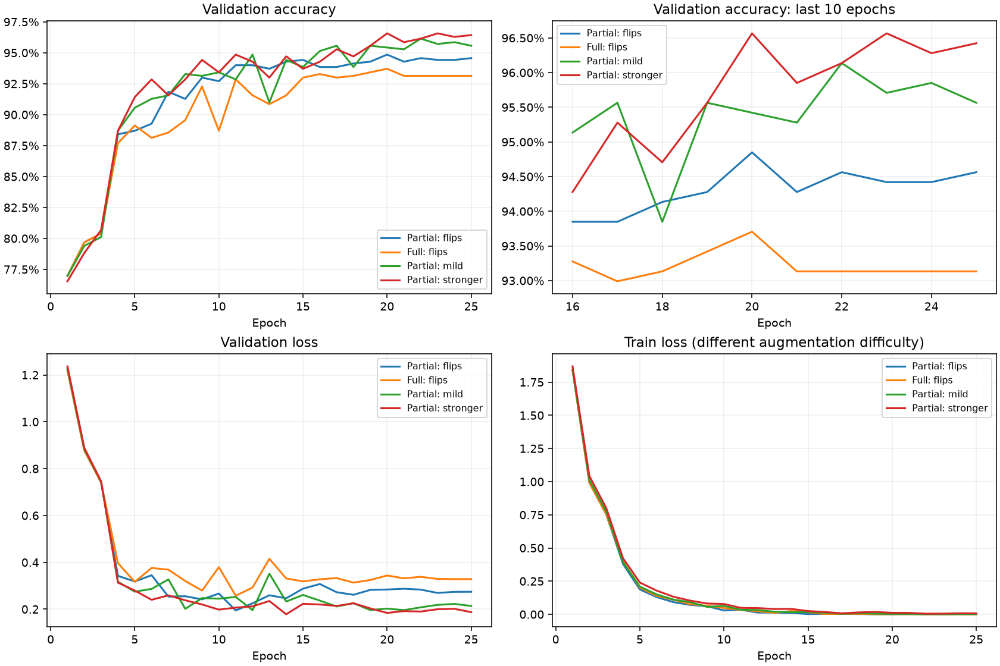
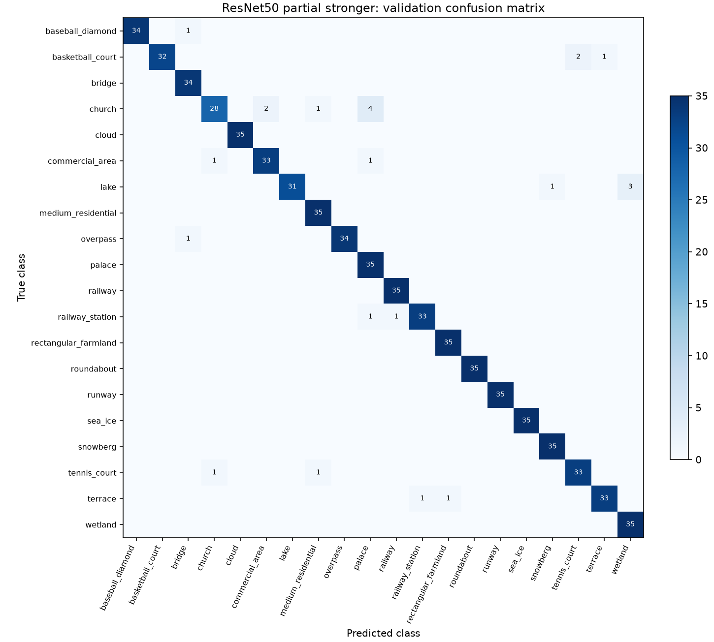
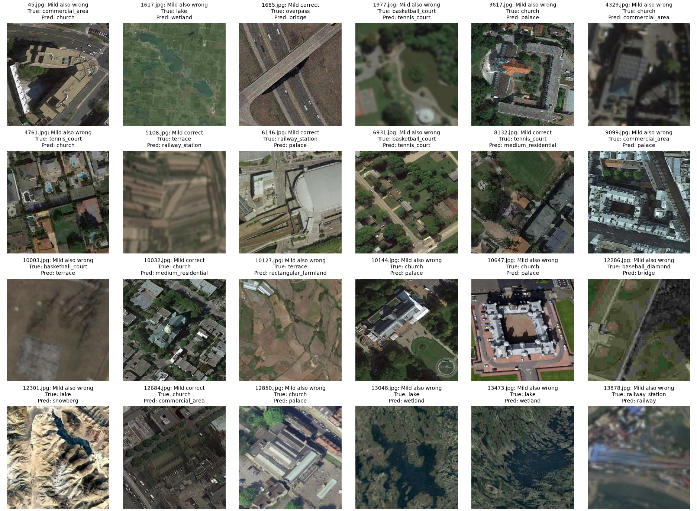

# ResNet50: partial/full и результаты аугментаций

Проверка 2026-10-05. Основной кандидат — resnet50_partial_domain_shift_stronger.json. Наблюдаемый результат: 96.57% (675/699), 24 ошибки. Мягкий domain_shift — близкий второй кандидат; усиленный выиграл лишь 3 изображения и требует повторов с другими seeds.

## Результаты и проверки

Источники: experiments.csv, фактические config/metadata/summary.json, history.csv/training.log, сохранённые val predictions и best/last checkpoints. Ground truth — data/raw/val.csv; class mapping — classes.csv. Test не читался.
Все новые запуски имеют одинаковые input 256, seed=42, batch 32, 25 epochs, warmup 3, pretrained V2 weights, ImageNet normalization, AdamW/LR, scheduler и dropout. Full отличается только режимом разморозки и отсутствием списка partial-blocks; BN running statistics frozen у всех. Варианты stronger/mild отличаются только диапазонами blur и downscale.

| ResNet50-рецепт | Best Accuracy | Верных / 699 | Ошибок | Best epoch | Время, мин | Val loss на best Accuracy |
| --- | --- | --- | --- | --- | --- | --- |
| Partial, flips: повтор контроля | 94.85% | 663 | 36 | 20 | 18.33 | 0.2841 |
| Full, flips | 93.71% | 655 | 44 | 20 | 31.27 | 0.3440 |
| Partial, mild domain_shift | 96.14% | 672 | 27 | 22 | 18.87 | 0.2081 |
| Partial, stronger blur/downscale | 96.57% | 675 | 24 | 20 | 18.85 | 0.1841 |

Оригинальный resnet50_partial_001 тоже 94.85%, 17.05 мин.
Повтор контроля совпал с оригиналом по learning metrics всей истории, всем val predictions и каждому тензору best model state. Это подтверждение технической повторяемости в данном окружении, не независимый seed и не дополнительные 699 наблюдений.
Все истории полные; метрики finite; Accuracy журнала/summary/history max/val predictions согласованы; 699 уникальных IDs и true_label проверены. Best/last checkpoints проверены по epochs, best_epoch, saved best accuracy, class order, голове 20×2048, optimizer/scheduler и конечности весов. Замороженные части между best/last сохранены, включая BN statistics.
Хеши и подробные вычисления — resnet50_followup_audit.json. Настоящий повторный inference локально не запускался: torchvision отсутствует; установки/загрузки весов не выполнялись. Это ограничивает проверку соответствия checkpoint и CSV прямым inference, но несогласованностей метрик/состояний не найдено. Код, конфиги и исходные результаты не менялись.

## Partial против full

Теперь сравнение чище предыдущего ResNet18: одинаковы epochs, LR, BN policy и аугментации.
Full проиграл partial-контролю на 1.14 п.п., восемь изображений. Он исправляет 7 ошибок partial, но портит 15 его правильных ответов. Последние 5 эпох: full 93.13%, partial 94.45%; last loss 0.3283 против 0.2743. То есть это не только проигрыш случайного best peak.
Вместе с большей стоимостью наблюдаемое full не даёт основания заменять partial. Partial уже обучает layer3/layer4/head —22.10 млн из 23.55 млн параметров (около 94%); full дополнительно меняет ранние блоки и stem, что не помогло текущему протоколу.
Возможная гипотеза: ранние ImageNet-признаки лучше сохранять, а их адаптация требует отдельного меньшего LR/BN-протокола. Здесь не измерялась причина ухудшения и не доказано catastrophic forgetting.

Full c сильными аугментациями ещё не обучался. Поэтому вывод: partial — основной путь сейчас, full без фотоискажений — неудачный текущий рецепт. Можно провести один matched full+stronger эксперимент после проверки устойчивости partial; не нужно сразу строить широкую сетку full LR и epochs. Если full снова не даст устойчивого прироста — отложить его.

Для Full vs control exploratory paired McNemar p≈0.134. Один seed и выбор best epoch не позволяют объявить частичный режим универсально лучше. Практическое решение учитывает Accuracy, loss, поздние эпохи и затраты данного рецепта.

## Аугментации

Mild против partial flips: +1.29 п.п., +9 правильных ответов; ошибок 36→27 (на 25% меньше).
Stronger против partial flips: +1.72 п.п., +12 правильных ответов; ошибок 36→24 (на 33.3% меньше).
Stronger против mild: +0.43 п.п., +3 ответа.

Парные результаты:
- Mild исправляет 12 ошибок контроля, портит 3 его правильных ответа.
- Stronger исправляет 16 ошибок контроля, портит 4.
- Stronger исправляет 9 ошибок mild, портит 6 его правильных ответов;18 ошибок остаются общими.

Таким образом photo/corruptions имеют содержательный положительный эффект в данном запуске. У stronger ниже best/last val loss и выше средняя Accuracy последних 5 эпох: 96.25% против 95.71% mild и 94.45% control.
Exploratory paired p для stronger/control≈0.0118, mild/control≈0.0352, stronger/mild≈0.607. Эти p не учитывают выбор лучшей эпохи, перебор рецептов/множественные сравнения и разброс по seeds; не используются как доказательство общего ранжирования.

Mild и stronger различаются сразу по двум диапазонам (blur и downscale). Из этого сравнения нельзя узнать, помог один из них или их сочетание. Вероятности операций, noise/JPEG/color/gamma не менялись; конкретным источником улучшения не следует объявлять любой отдельный компонент.

По времени пользовательское наблюдение подтверждается: новые partial-run 18.33/18.87/18.85 мин, медиана последних 10 эпох 46.14/46.40/46.39 с. Для текущей серии можно выбирать аугментации по качеству; разница времени мала и не обосновывает отказ от них.
Full 31.27 мин и 79.85 с/эпоха — примерно на 71–73% дороже повторного partial-контроля. Время оригинального partial17.05 мин отражает другой запуск, а не выигрыш рецепта с теми же метриками.

## Где остаются ошибки

Val по 35 примеров на класс, bridge34. Train по 250, palace249: проблема не объясняется дисбалансом количества классов.

| Истинный класс | Ошибок у stronger | Recall | Control: ошибок | Mild: ошибок |
| --- | --- | --- | --- | --- |
| church | 7/35 | 80.00% | 9 | 7 |
| lake | 4/35 | 88.57% | 7 | 6 |
| basketball_court | 3/35 | 91.43% | 3 | 3 |
| commercial_area | 2/35 | 94.29% | 2 | 2 |
| railway_station | 2/35 | 94.29% | 3 | 1 |
| tennis_court | 2/35 | 94.29% | 2 | 1 |
| terrace | 2/35 | 94.29% | 1 | 1 |

Church/lake/basketball дают 14 из 24 ошибок (58%). Stronger не улучшает каждый класс: mild лучше railway_station/tennis_court/terrace; stronger лучше lake/palace/railway/rectangular_farmland/snowberg/wetland.
У palace100% recall (35/35), но precision85.37%: сеть предсказывает palace41 раз, шесть из них ошибочны. «Нет ошибок среди истинных palace» не означает идеальное различение palace от других зданий.
Частые пары stronger: church→palace4, church→commercial_area2, lake→wetland3, basketball_court→tennis_court2. Полная class precision/recall/F1 и остальные пары сохранены в JSON.

## Визуальная проверка всех 24 ошибок

Просмотрены все 24, а не только несколько наиболее эффектных примеров. Наблюдения и гипотезы:
- Church: часть roof/building layouts визуально похожа на palace/commercial_area; это семантическая граница и контекст, а не только шум. Есть резкие ошибочные 10144/10647/12850, noisy3617 и blurred4329. Нельзя утверждать, что модель «смотрит только на фон», без отдельного анализа.
- Lake/wetland: в 1617 сильная пикселизация;13048/13473 содержат сочетание воды и растительности, визуально похожее на wetland. В 12301 вода мала относительно светлых гор — модель выбрала snowberg. Причины смешанные: потеря деталей, масштаб объекта, похожие окружающие признаки.
- Basketball/tennis:1977 сильно blurred;6931 содержит небольшой court среди жилья; разметка/границы площадки могут теряться.10003 столь сильно размыт, что форма объекта плохо читается.
- Terrace/railway_station: формы террас похожи на параллельные полосы/пути; есть blurred5108/13878, но 6146 достаточно резкий, с доминирующим зданием и путями вокруг.
Некоторые ошибки возникают на хорошем качестве. Дальнейшее усиление blur/noise не обязано помочь семантическим случаям, а может ухудшить class-specific details.
Метки не объявляются неправильными и не переопределяются. Проверка определения church/palace/lake/wetland и train-примеров уместна; плохое предсказание само по себе не доказывает ошибку разметки.

Не добавлять class weights автоматически: train сбалансирован. Не увеличивать image_size ради «новых деталей»: исходники 256, upscale не восстановит утраченную информацию.
Полезнее сравнить train-примеры слабых классов, определить какие признаки различают похожие сцены, затем проверять конкретную гипотезу. Агрессивный crop может убрать маленькую площадку или важное окружение, поэтому не включается первым шагом.

## Что делать дальше

1. Повторы mild и stronger с seeds123 и 2026, остальные настройки неизменны (seed=42 уже есть). Контроль можно повторить на тех же seeds для устойчивой оценки фотоискажений. Сравнивать среднее/разброс и paired ошибки. Повтор того же seed=42 уже подтвердил repeatability, но не ranking across seeds.
2. TTA на сохранённых best models, сначала original/H/V/HV (четыре ориентации из уже использованных отражений), усреднение probabilities на val. Затем ensemble mild/stronger или независимых seeds по probabilities, если это улучшает val. У mild/stronger18 общих ошибок; теоретический oracle limit681/699=97.42% не является результатом реального ансамбля. CSV содержат только argmax labels: для soft ensemble/TTA потребуется дополнительный inference и сохранение probabilities/logits.
3. Один отдельный regularization experiment: label_smoothing=0.05 на перспективном partial-рецепте, без одновременной смены augmentation/LR/epochs. Это гипотеза, не гарантированный прирост. [CrossEntropyLoss поддерживает label_smoothing](https://docs.pytorch.org/docs/stable/generated/torch.nn.CrossEntropyLoss.html), но текущий pipeline использует обычную CE и не читает этот параметр из config; потребуется добавить поддержку. Более высокий train loss при smoothing нельзя напрямую сравнивать с обычной CE.
4. Если хочется окончательно проверить full: один full+stronger с теми же settings/BN-policy. Это проверит interaction режима и аугментаций. Более низкий LR ранних блоков/другая BN policy — отдельные будущие гипотезы при необходимости, не часть первого сравнения.
5. Небольшая component ablation blur-only versus resolution-only имеет смысл после устойчивого выбора, если нужно понять источник прироста; сейчас оба усиливались вместе. Не усиливать дополнительно всё и не искать много архитектур/эпох ради последних единиц val.
6. Зафиксировать выбранный recipe/seed или ensemble и собрать воспроизводимый 99_final_pipeline.ipynb. Test используется для inference выбранного решения, не для fitting или подбора. Много решений выбираются по одной val, поэтому 96.57% — best наблюдаемая validation Accuracy, не обещание такого же test/public score.

Приоритет: стабильность partial+aug → TTA/ensemble → один regularization experiment. Full остаётся дополнительным исследованием, не основным направлением. Данные, модели, журнал и конфиги в этом обзоре не менялись.

