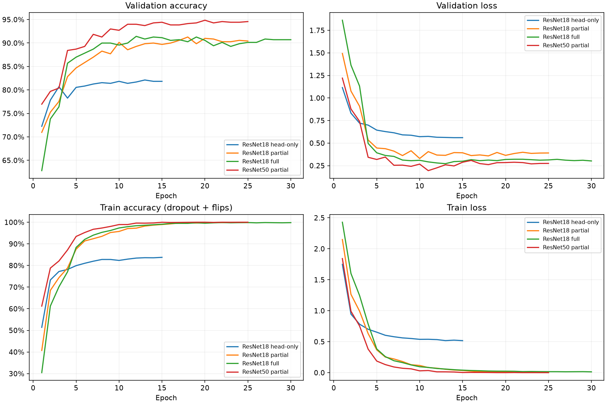
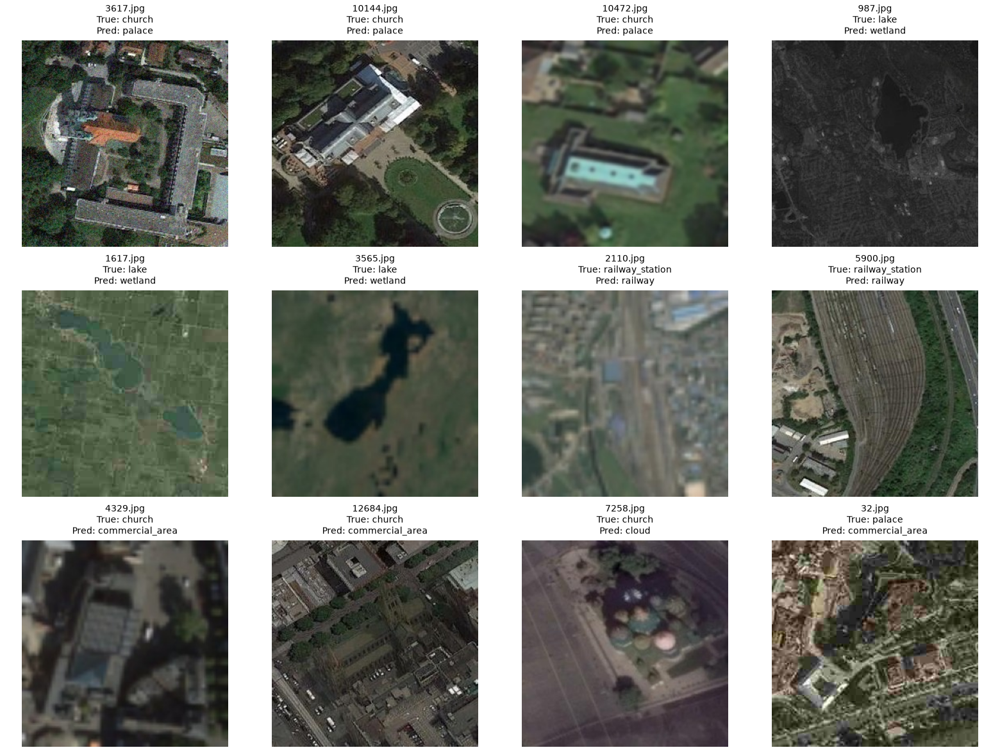
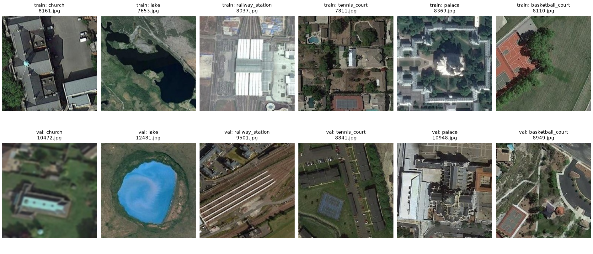

# ResNet: результаты, режим обучения и аугментации

Анализ 2026-10-05. Основной кандидат — ResNet50 partial (94.85%). Практичный более дешёвый ориентир — ResNet18 partial (91.27%). Head-only нужен как baseline transfer learning; full на ResNet18 не дал убедительного прироста Accuracy. На ResNet50 full ещё не проверялся.

## Результаты и целостность

Источники: experiments.csv, config/metadata/summary.json и history.csv из artifacts/logs, val.csv из artifacts/predictions, best/last.pt из artifacts/models, исходные val.csv/classes.csv. Конфиги брались из артефактов фактических запусков.
Все четыре запуска — Tesla T4, seed42, вход256×256, ImageNet-нормализация, только horizontal/vertical flips по0.5.

| Рецепт | Best Accuracy | Верных / 699 | Ошибок | Лучшая эпоха / всего | Время, мин |
| --- | --- | --- | --- | --- | --- |
| ResNet18 head-only | 82.12% | 574 | 125 | 13 / 15 | 6.10 |
| ResNet18 partial | 91.27% | 638 | 61 | 18 / 25 | 6.30 |
| ResNet18 full | 91.42% | 639 | 60 | 12 / 30 | 12.96 |
| ResNet50 partial | 94.85% | 663 | 36 | 20 / 25 | 17.05 |

Истории полные, метрики конечные; журнал, summary, history maximum и Accuracy сохранённых predictions совпали. Все699 ID уникальны и соответствуют raw val, true_label и классы проверены.
Проверены best/last checkpoints: эпохи, best_epoch, сохранённая Accuracy, class order, shape головы, конечность тензоров, optimizer/scheduler. У head-only/partial замороженные части между best и last не менялись; замороженные running statistics BatchNorm сохранены. Full обновлял BN statistics, как задано freeze_bn=false.
Подробные числа/хеши: resnet_audit.json. Локально torchvision отсутствует: повторный inference настоящих ResNet не запускался, библиотеки/веса не скачивались. Это ограничение проверки, а не обнаруженная ошибка результата.

## Head-only, partial или full

Head-only уже существенно лучше лучшего собственного CNN: 82.12% против72.82%, +65 правильных ответов. Но при head-only ограничена адаптация признаков: дообучается только Linear на20 классов (10 260 параметров), backbone и BN statistics заморожены. В конце train83.76%, val81.83%; низкий train здесь не требует автоматически больше эпох — признаки и голова имеют ограниченную адаптацию. Замороженная ImageNet-сеть даёт полезный старт, но не лучший финальный рецепт.

ResNet18 partial адаптирует layer4 и голову после3 warmup-эпох, оставляя ранние блоки и BN running statistics замороженными. Прирост против head-only: +9.16 п.п., +64 ответа. Исправлены74 ошибки head-only, испорчены10 правильных ответов. Это сильное наблюдаемое улучшение данного рецепта.

ResNet18 full даёт против partial только +0.14 п.п., один ответ. В парном сравнении исправляет20 ошибок partial, портит19 её правильных ответов. Full вдвое дороже по общему времени (12.96 против6.30мин) и примерно в1.84 раза дороже по медиане последних10 эпох (27.0 против14.7с).
При этом full имеет меньший val loss: на best Accuracy эпохе0.280 против0.358 partial; его нельзя считать полностью бесполезным. Меньший CrossEntropy не доказывает лучшую калибровку без анализа вероятностей.
Для оптимизации Accuracy/стоимости сейчас partial предпочтительнее. Это не доказывает, что full всегда хуже или что full на ResNet50 не поможет.

Сравнение режимов не чистая абляция: head-only15, partial25, full30 эпох; различаются LR головы/тела и freeze_bn. Поэтому результат относится к рецептам в целом. Для исследования собственно режима нужен одинаковый протокол с отдельной фиксацией BN-политики и разумными LR, повторённый на нескольких seeds.

ResNet50 partial улучшает ResNet18 partial на3.58 п.п., +25 ответов: исправлено36 ошибок, испорчено11. Против ResNet18 full: +3.43 п.п., +24 ответа.
Он дообучает layer3+layer4+голову: 22.10млн из23.55млн параметров, около94%. Это частичная адаптация по структуре блоков, но уже большая часть параметров модели, а не обучение одной небольшой головы.
Кроме архитектуры различаются число размороженных блоков, backbone LR и pretrained weights: ResNet18 V1, ResNet50 V2. V2 использует другую тренировочную recipe согласно [torchvision ResNet50 docs](https://docs.pytorch.org/vision/0.21/models/generated/torchvision.models.resnet50.html). Весь прирост нельзя приписать одной глубине ResNet50.

По каждому рецепту пока один seed; выбор checkpoint/рецепта сделан по одной val. Exploratory парные сравнения в JSON помогают описать ошибки, но не заменяют повторы и не учитывают все эффекты выбора.

## Кривые и переобучение

Head-only стабилизируется около82%.
Partial/full быстро почти идеально классифицируют train, но val остаётся около91%; качество val после лучших эпох не растёт устойчиво.
Для ResNet50:
- минимальный val loss0.194 на эпохе11 при Accuracy93.99%;
- максимальная Accuracy94.85% на эпохе20, val loss0.284;
- train Accuracy100%, loss0.00047 в эпохе20; в конце loss0.00030;
- последняя val Accuracy94.56%, loss0.274.

Рост loss при почти постоянной/чуть растущей Accuracy согласуется с усилением уверенности в оставшихся ошибках; без сохранённых probabilities это гипотеза, а не измеренная калибровка. Главный следующий вопрос — обобщение/устойчивость, а не увеличение epochs.
Для метрики Accuracy best на20 корректно выбран по объявленному критерию; минимум loss на11 не означает, что надо автоматически заменить best. Текущий pipeline сохраняет Accuracy-best и last, а отдельный min-loss checkpoint не сохранён.
Аугментации — первая отдельная проверка. Label smoothing0.05–0.1 может стать следующим кандидатом регуляризации, если останется проблема уверенных ошибок; поддержка его настройки criterion сейчас потребует добавления в код. Не смешивать его изменение с первым сравнением аугментаций.
Сокращение обучения/early stopping исследовать отдельно; изменение epochs меняет весь cosine schedule. Просто взять более ранний min-loss checkpoint из уже имеющихся артефактов нельзя, если его не сохраняли.

## Оставшиеся ошибки

ResNet50 partial: church26/35=74.29%, lake28/35=80%; далее basketball_court и railway_station32/35=91.43%.
Palace и tennis_court выросли до33/35 каждый; эти прежние слабости собственной CNN в значительной степени устранены.
Частые ошибки: lake→wetland6; church→palace5; railway_station→railway3. Все четыре ResNet одновременно ошибаются на23 снимках.
Просмотрены12 целенаправленно выбранных ошибок; это не репрезентативная оценка частоты дефектов.

Есть семантические ошибки на достаточно резких снимках (похожие сооружения/окружение) и ошибки на сильном blur, грубой пикселизации, тёмных изображениях, цветном шуме и локальных цветовых изменениях.
Примеры val: church10472.jpg/4329.jpg — потеря резкости; lake1617.jpg — грубая пикселизация; lake987.jpg — очень тёмный кадр; church3617.jpg — видимое цветное зерно; railway_station2110.jpg — заметно размытые детали.
Это основания для экспериментов по устойчивости, полученные из val; не все36 ошибок объясняются качеством фото.
Метка lake/wetland может требовать контекст/растительность; сильный saturation/hue способен уничтожить такие признаки. Метки не переопределялись.

## Что видно в notebook и достаточно ли аугментаций

Использован существующий PNG-output ячейки10 в 00_data_overview.ipynb; ячейка читает test.csv и test/, хотя переменная названа val_df.
Она показывает100 случайных test-изображений без названий/ID, random_state=None. Ячейка не перезапускалась; никаких статистик или параметров по test не вычислялось.
В этой сетке видны резкие кадры и заметно размытые кадры, потеря мелких деталей, различия экспозиции/контраста/цветопередачи, несколько выцветших/сероватых снимков. Нельзя по thumbnails уверенно установить тип сенсорного шума, JPEG quality или отделить blur от изначально низкого разрешения.
Облака/лёд/яркие снежные области часто являются содержимым класса, а не технической порчей. Cloud — отдельная целевая категория; искусственное закрытие кадра облаками может нарушить смысл метки. Не включать его автоматически.

Train тоже неоднороден: выбранный пользователем train-пример тёмный; в независимых train-примерах есть тени/мягкость/дымка. «Чистый train» не означает, что все кадры идеально резкие и яркие.
Для иллюстрации из train и val выбраны по одному независимому изображению шести классов с seed42; это разные сцены, не пары до/после порчи и не оценка всего распределения.

Существующий CNN domain_shift действительно консервативен:
- blur sigma/radius0.2–1.0px;
- down/upscale0.65–1.0: минимальное промежуточное разрешение около166×166;
- brightness/contrast/saturation±15%, hue±0.02;
- gamma0.85–1.15, noise std0.005–0.025;
- общий corruption gate0.65, индивидуальный blur p0.25, максимум2 corruptions.

Фактическая частота blur не выше0.65×0.25=16.25% до ограничения бюджета; resolution_degradation — не выше13%. Некоторая доля выраженных искажений на val явно тяжелее таких мягких преобразований. Однако «сильнее» не значит «лучше»: исходные small objects и границы классов можно уничтожить.
Главное: ни один текущий ResNet-run вообще не использовал этот domain_shift, только flips. Поэтому вывод «аугментации не помогают ResNet» пока невозможен.

Test-картинки используются только для ответа о видимых особенностях. Точные диапазоны и выигрыш будущих аугментаций выбирать по train/val, без fitting preprocessing, representations, clustering или подбора модели по test.

## Следующий план

1. Зафиксировать текущий ResNet50 partial с flips как контроль. На нём выполнить один эксперимент с существующим мягким domain_shift, сохранив seed42, weights V2, input256, ImageNet normalization, 25epochs, warmup3, optimizer/LR, dropout и BN-политику.
   При переносе CNN augmentation убрать random_rotate90, если требуется сравнить именно фотоискажения: текущий ResNet-контроль имеет только flips. Добавление поворотов одновременно изменит геометрический рецепт.
2. Отдельным рецептом усилить только blur/снижение детализации, подтверждённые на val: например пробный blur0.5–2.5px, down/upscale0.4–1.0, с умеренной вероятностью и сохранением чистых/слегка искажённых кадров. Это стартовые гипотезы, не измеренные параметры test. Остальные photo/noise настройки оставить как в мягком варианте, чтобы понять причину изменения.
   Отдельное изменение контраста/gamma/noise исследовать лишь при полезном результате/подтверждённых оставшихся ошибках; не усиливать всё одновременно.
3. Повторить лучший контроль/augmentation-рецепт с seeds123 и2026 (seed42 уже есть). На val699 одна ошибка=0.143п.п.; у модели осталось36 ошибок, поэтому небольшие улучшения могут быть случайными.
4. ResNet50 full — дополнительная проверка после аугментаций/повторов, не обязательный первый шаг. Начать с небольшого backbone LR и BN statistics frozen для более понятного сравнения; BN train отдельно, если потребуется. Частичный режим уже адаптирует около94% параметров.
5. Позже, при необходимости, проверить TTA отражения/повороты на val и ансамбль независимых seeds по вероятностям. Ошибки моделей частично различаются, но это не гарантия улучшения ансамбля. Test применять только к выбранному pipeline для inference.
Собственные MLP/CNN и head-only больше не расширять. Широкий поиск других архитектур/тысяч эпох сейчас не нужен.

Анализ не меняет notebook, конфиги запусков, experiments.csv, raw и исходные artifacts. Новые конфиги и поддержка loss/early stopping не реализовывались в рамках этого обзора.

